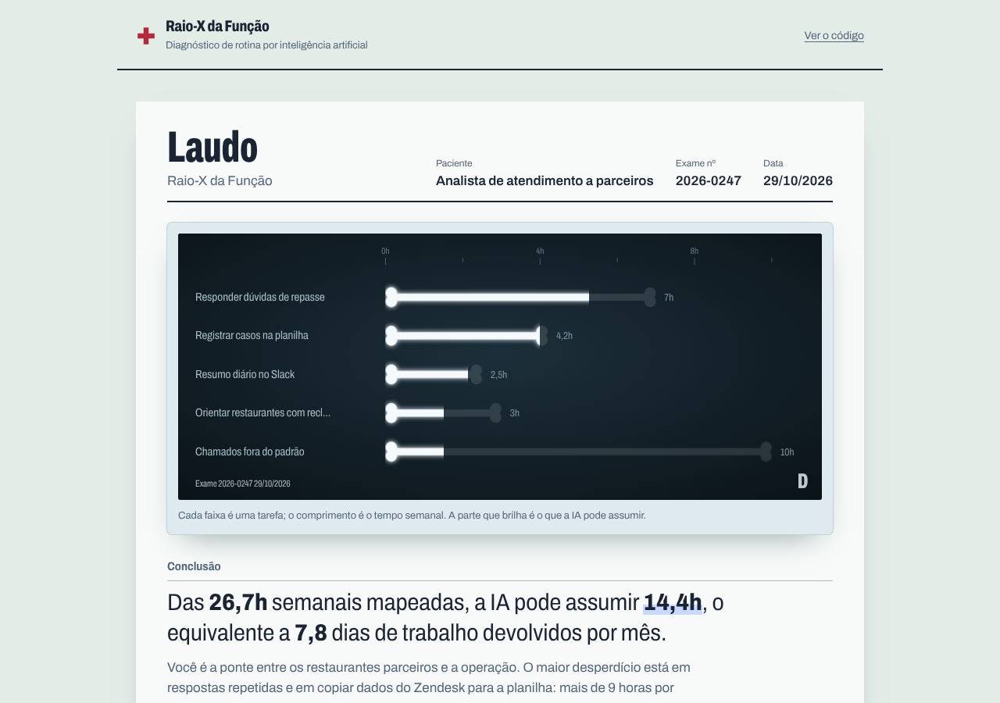
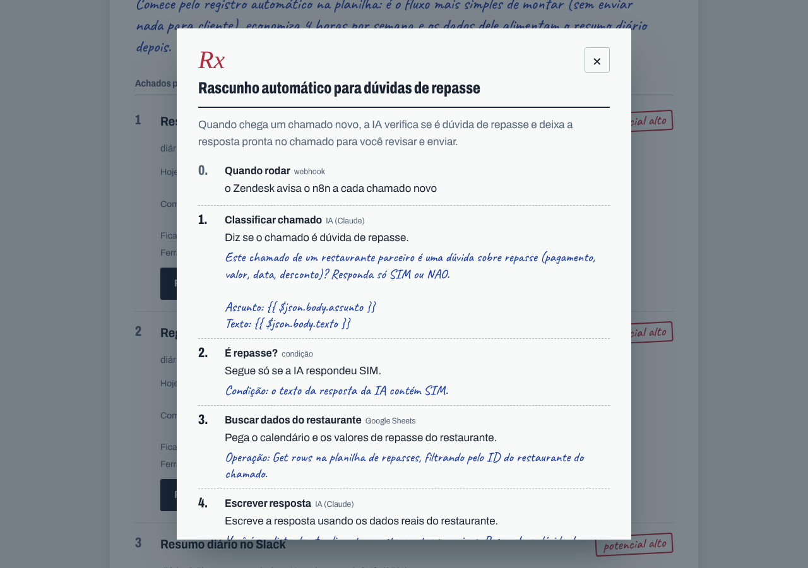

# Raio-X da Função

**Um agente de IA faz a anamnese da sua rotina, emite um laudo com as horas que a IA pode assumir e receita o fluxo pronto para importar no n8n.**

🔗 **[Abrir o app](https://[seu-link].pages.dev)** · 🎬 **[Vídeo de 2 minutos](https://[link-do-video])**



## O problema

Todo mundo ouve que "a IA vai automatizar parte do seu trabalho", mas quase ninguém sabe **qual parte**, **quantas horas** isso representa e **por onde começar**. Empresas que adotam IA como princípio pedem que cada pessoa redesenhe a própria função criando agentes, e o primeiro passo, mapear a rotina, ainda é feito na intuição.

## Por que eu construí isso

Cada vez mais empresas tratam IA como princípio, não como projeto: esperam que cada pessoa redesenhe a própria função criando agentes que assumam as tarefas repetitivas. Só que antes de criar o agente é preciso responder uma pergunta que quase ninguém mede: **onde estão as horas?**

O Raio-X faz esse diagnóstico em cinco minutos e já entrega o primeiro agente pronto para rodar. Os exemplos vêm do ecossistema de delivery, onde a mesma lógica aparece em três áreas bem diferentes:

| Exemplo | Horas mapeadas por semana | A IA pode assumir | Primeiro fluxo receitado |
| --- | --- | --- | --- |
| Atendimento a restaurantes parceiros | 26,7h | 14,4h | Rascunho automático para dúvidas de repasse |
| Operações com entregadores | 23,3h | 14h | Resposta automática no WhatsApp para dúvidas de pagamento |
| Comercial de novos restaurantes | 33h | 15,7h | Cardápio por foto: da imagem para a planilha de cadastro |

> Os exemplos são cenários ilustrativos que escrevi para demonstrar o app, não dados reais de nenhuma empresa.

## O conceito

O app leva o nome ao pé da letra e funciona como um exame de verdade:

- **Ficha e anamnese.** As perguntas do agente aparecem impressas; as respostas da pessoa, em letra de caneta azul.
- **Laudo com chapa.** Cada tarefa vira um osso numa chapa de raio-x: o comprimento é o tempo semanal e a parte que brilha é o que a IA pode assumir. O laudo pode ser impresso ou salvo em PDF.
- **Receita.** O fluxo do n8n vem como uma receita, passo a passo, com o prompt de cada etapa escrito à mão.



## Como funciona

1. **Entrevista.** O agente faz de 5 a 8 perguntas, uma por vez, sobre o seu dia. Quando a resposta é vaga ("demora um pouco"), ele pede números.
2. **Raio-X.** Com informação suficiente, o agente chama uma ferramenta que devolve um diagnóstico estruturado: cada tarefa com frequência, horas por semana, percentual automatizável, como automatizar e **o que deve continuar humano**.
3. **Fluxo pronto.** Para cada tarefa você gera um workflow do n8n: o arquivo `.json` importa direto, com cada nó explicado e os prompts de IA já escritos.

```
Perfil ─► Entrevista (Claude + tool use) ─► Raio-X estruturado ─► Plano do fluxo ─► Workflow n8n (.json)
```

## Resultados

| Teste | Pessoas | Horas/semana identificadas como automatizáveis |
| --- | --- | --- |
| [preencher] | [X] | [X] |

> Ainda vou rodar com pessoas reais e atualizar esta tabela.

## Decisões técnicas

- **Tool use com esquema fechado.** O relatório e o fluxo saem por *tool use* com JSON Schema, não por texto livre. Isso garante que o frontend sempre recebe os campos certos.
- **A IA planeja, o código monta.** A IA escolhe os passos do fluxo de uma lista fechada de tipos (`ia_claude`, `google_sheets`, `gmail`, `condicao`…). O JSON do n8n é montado de forma determinística em [`public/n8n.js`](public/n8n.js), então o arquivo sempre importa sem erro.
- **Humano no circuito.** O prompt pede que todo fluxo mantenha a parte de julgamento com a pessoa (por exemplo, a IA deixa um rascunho para aprovação em vez de enviar sozinha).
- **Percentuais realistas.** O agente é instruído a não passar de 30% em tarefas de julgamento, negociação ou empatia. O cálculo de horas é feito no frontend, não confiado ao modelo.
- **Chave protegida.** A chave da API fica só no servidor (Cloudflare Pages Functions). O backend limita o tamanho das entradas e o número de turnos.
- **Modo demonstração.** Um roteiro pré-gravado deixa qualquer pessoa ver o produto inteiro sem gastar chamadas de API.

## Stack

Claude API (tool use) · Cloudflare Pages + Pages Functions · JavaScript puro, sem framework · SVG desenhado no código para a chapa · fontes Archivo e Caveat embutidas · n8n · testes com `node:test`

## Rodar localmente

```bash
npm install
cp .dev.vars.example .dev.vars   # coloque sua ANTHROPIC_API_KEY
npm run dev                      # http://localhost:8788
npm test
```

## Publicar no Cloudflare Pages

```bash
npx wrangler login
npx wrangler pages deploy
npx wrangler pages secret put ANTHROPIC_API_KEY
```

## Estrutura

```
public/            frontend: app.js, chapa.js (desenho da chapa), n8n.js (montador do workflow), demo.js, fontes/
functions/api/     entrevista.js e fluxo.js (Pages Functions que chamam a Claude API)
lib/               cliente da Claude API
tests/             testes do backend e do montador do n8n
```

## Próximos passos

- Exportar o Raio-X de uma equipe inteira (somar as horas de várias pessoas).
- Gerar também o fluxo para Make e Zapier.

---

Feito por **Thalita Santos das Neves** · [GitHub](https://github.com/thalitadevops) · [LinkedIn](https://linkedin.com/in/[seu-perfil])
